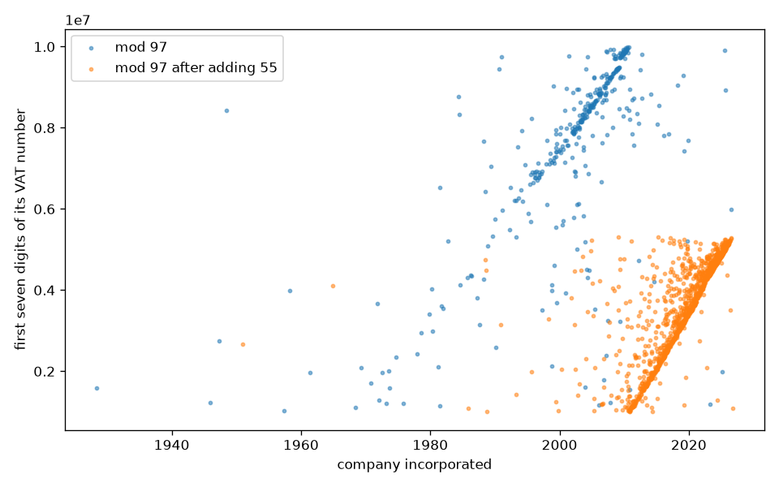

# UK company VAT numbers from the open web

My take-home for the Veridion Data Assets Intern track ("VAT Identifier Discovery"). The question is
whether a dataset of UK company VAT numbers can be built from the open web, proven on a sample.

## Short answer

Partly, and not in the way I expected when I started.

The open web gives a VAT number for about 1 company in 100 on the register. On 400 live companies
drawn at random, weighted by how many companies each size band stands for, that is 1.35 strict
finds per 100, and HMRC shows 0.98 per 100 under the company's own name. Where a page proves whose
number it is, with the company's registration number next to it, the number is usually right: on
registered companies it was Peppol's number 96 times out of 98, and HMRC showed the company for
all 17 of those I checked. On the register sample it was messier. HMRC showed the company itself
for 3 of the 6 strict finds, and the other 3 were a VAT group's number, the founder's own
registration and a number that is not live any more.

Crawling more would not change this much. Only 38% of registered companies with a site I could
prove print their number, one number can belong to several companies, and sites keep old numbers.
So I would not sell a dataset built from the web as the answer to this customer. Their own invoices
already carry the number, Peppol has 22,485 UK numbers today, and from 1 April 2029 VAT invoices have
to be e-invoices over Peppol. The web is useful for the gaps and as a second opinion.

## How I worked

I kept a notebook of every run, in the order things happened, with the commands and what came back:
`research/log.md`. The pipeline is in `src/ukvat`, the probes in `experiments/` (one script each),
and every number in this README is printed by one file:

```
python -m ukvat.run_sql sql/numbers.sql
```

I went company first, not crawl first. Harvesting VAT numbers from a crawl only finds the companies
that publish, which is the sample the brief rules out, and it cannot say what share of the register
is reachable. So I start from a company and look for its number, and the crawl is in here as a
probe of coverage and cost. Python fetches and reads the pages, and DuckDB SQL does the sample, the
joins and the counting.

I used two samples. 400 live companies drawn at random from the Companies House snapshot of 1 Nov
2026, 100 from each size band, where "not found" can also mean "not registered". And 1,401
companies whose VAT number I already knew from Peppol, the e-invoicing directory, where "not found"
can only mean that my method failed.

Every number I count as found went through HMRC's web checker (gov.uk/check-uk-vat-number). The
API for the same check is behind an application since February 2025 and HMRC says it is for traders
doing due diligence, so I did not use it. The checks were typed into the web checker by an automated
browser, one number at a time and only numbers I had already found. When the checker answered 429 it
waited and went on slower.

## Research (part 1)

### A VAT number carries its own date

UK numbers pass the check digits in one of two ways, mod 97, or mod 97 after adding 55. On 13 Nov I
noticed that the numbers on young companies were all of the second kind, and my guess was that this
kind is handed out in order.

It is. I joined 15,359 numbers to the incorporation date of their company (Peppol cards, crawl
pages, my own finds). For the 11,963 of the newer kind the number rises with the date, rank
correlation 0.869. A company registers for VAT after it is incorporated, never before, so for each
band of 100,000 numbers I took the date of the newest companies holding it (90th percentile) as the
date the band was issued. The bands then move at about 282,000 numbers a year. HMRC's statistics
say 234,000 new registrations in 2024 to 2025, closer than I expected.

The chart (`results/probes/vat_number_age.png`) has two ridges. The older kind climbs until about
2010 and stops at the top of the seven digit range, and the newer kind starts again from the bottom
in 2010.



This is a test before any call to HMRC. A number much older than its company is either a
registration the company took over, usually from a sole trader who incorporated and kept the
number, or a wrong link. 362 numbers look older than their company. HMRC's EORI record names 84 of
them and 76 are the company's own. One of my register finds shows the other side: CLIMETECH LTD was
incorporated in July 2025, its site prints a number of the older kind, and HMRC shows that number
under a person's name at the company's address.

### Most registered companies do not print their number

Regulation 6 of the E-Commerce Regulations 2002 asks a business that sells online to show its VAT
number. Of the 1,401 companies I know are registered, 255 have a site that shows their company
number, and 98 of those print the VAT number, 38.4% (32.7 to 44.5, Wilson interval). By size band
it is micro 39 of 105, small 51 of 125, large 2 of 9.

For the 155 silent sites I read the html again. In 2 the number was there and my reader missed it,
17 link a pdf where it may be, and 136 do not have it anywhere. So even with every website known,
the web route stops at about 4 in 10 of the registered companies that have one.

### A number with proof is right, one without proof often is not

I believe a site is the company's only if it shows the company's own registration number, which the
same regulation asks for. A find is strict when there is exactly one valid VAT number on such a
site, and loose when the one number is on a guessed site with no such proof. On the known set the
strict finds equal Peppol's number 96 times in 98 and the loose ones 3 times in 13. On the register
sample HMRC put 3 of the 4 loose finds under another name: the ordering platform behind a takeaway's
site (EPOS Technologies on Kebab City's terms page), the registrar of a parked domain (Freeola), and
a different company with the same initials.

### Sites go out of date

Both strict disagreements with Peppol are sites showing an older number. Virtus IT's site has a
number of the older kind, from around 2009 when the company was incorporated, and Peppol has one
from the newest band on a card of 28 Oct 2026. Invatech Health's site has a number from a band of
about 2014, older than the company (2019), and Peppol one from early 2026. HMRC shows both of
Peppol's numbers live under the company's own name, and it has no registration at all for either
of the old numbers on the sites. In both pairs the age of the number already said which one to
trust.

ETORROS LTD on the register sample is the same story. Its site shows a number in the band of its
own incorporation year (2020), and HMRC says it is not a live registration, so I think it was the
company's and was cancelled.

### One number, several companies

In a VAT group one number covers many companies, and HMRC shows one member's name, sometimes a name
the company does not use any more. Of 7 numbers I found where HMRC's EORI name was another company,
Companies House's control data explains 3: a former owner, a sister company and an old holding
company. One number, 204979488, is on the sites of two companies of the Sykes Cottages group. For an invoice the group's number is right. As a key for a
company it is not, and a customer who merges suppliers on it merges two real suppliers.

### Names and postcodes prove less than they look

A third of live companies (32.8%) are registered at a postcode shared with 100 or more others, and
WC2H 9JQ alone has 75,154. 11.4% of companies share their name with another once the legal ending
and filler words go, 3.9% with only the legal ending dropped. The worst are families where only a
bracket differs, NAMECO (NO. x) 623 times. This is how the customer matches today.

### The register is being built in public

Peppol's directory has 22,485 valid UK VAT numbers. 12,148 of them were registered on one day, 25
Aug 2025, and since then it has been 342 to 682 new UK cards a month. HMRC's policy paper of 28 Oct
2026 makes e-invoices compulsory for VAT invoices from 1 April 2029, with Peppol as the network and
HMRC as the UK's Peppol authority. Today that authority sits in Supply Chain Coordination Limited,
the company that runs NHS Supply Chain.

### Sources that gave something

| source | what I ran | what came back | verdict |
|---|---|---|---|
| company websites, company first | 400 sampled companies, domains guessed from the name | 23 provably theirs, 6 strict and 4 loose finds | works where the site is known, which is rare |
| the same route on known numbers | 1,401 Peppol companies | 255 own sites, 98 strict finds, 96 equal to Peppol | the proof test works |
| Peppol Directory | the full export | 22,485 valid UK numbers, 15,259 names link to one live company | the best open source, and growing |
| HMRC's EORI checker | numbers I had already found | a name for 34 of 106 crawl pairs, 29 of them the company | a free second look, not a source |
| Common Crawl text | 4 of the 100,000 files of CC-MAIN-2026-43 | 172 pages with a valid number, about 22,000 hosts in a whole crawl | cheap, and small |
| Common Crawl index | the 58 sites that showed their company number live | 31 are in the crawl, and of the 21 with a VAT page live, 9 have that page in it | a corpus alone misses half |
| one hospital's spend file | its 34 supplier numbers | the web route finds 0 of the 19 it can link | the buyer's own data wins |

The crawl figure is a floor. Every host in the slice counts as one over its chance of being in four
files, and it assumes the pair is on every page of the host (standard error about 4,000).

### Dead ends

| where | why I tried it | what came back |
|---|---|---|
| Find a Tender, 3 to 10 Nov | every award names its suppliers | parties identified by PPON 4,071 times and by company number 1,608 times, never by a VAT number |
| The Gazette | insolvency notices name the business | "Company number" in 1,705,312 notices, "VAT No" in 28 |
| spend files, one per publisher on data.gov.uk | buyers hold their suppliers' numbers | 6 of 112 have a VAT number column, 4 of those are empty |
| filed accounts, two days | I guessed some small companies tag the number | none in 23,751 filings |
| Amazon and eBay seller pages | business sellers have to show a VAT number | both disallow Common Crawl's crawler and forbid scraping, so I fetched none |
| Nominet WHOIS | it could tie a guessed domain to a company | no registrant and no company number, and the .uk WHOIS stops on 9 Feb 2027 |
| pages saying "not VAT registered" | a way to tell "not registered" from "I failed" | 0 of 1,382 fetched pages, 2 of 83,776 crawl pages |

Two of these taught me more than the table says. In the spend files Shropshire Community Health NHS
Trust's VAT number column is full of VAT amounts (2.1, 10.49, 4.4), and only St Helens and Knowsley
fills it with numbers. The data is held by every buyer and publishing it is a choice. In the
accounts my first scan said 15 filings had a VAT tag, because the regex was case blind and matched
"DeriVATives". There are none. The accounts do say other things: 5 filings note the company is in a
VAT group and 4 that it is not registered.

## Proof of concept (part 2)

### The samples

The register sample is drawn from every Active company in the snapshot of 1 Nov 2026 that is not
dormant and not an Overseas Entity, 4,591,683. Accounts category is the only thing in the snapshot
that says anything about size, and turnover decides VAT registration, so I split by it: micro
1,686,224, small 1,444,419, large (medium, full, group and the subsidiary exemptions) 147,827, new
(no accounts yet) 1,313,213. 100 from each. The order inside a band is md5 of a seed and the company
number, so anyone with the snapshot draws the same 400, and nothing in it depends on what a company
publishes. Rates for the whole register are weighted by the size of each band.

The known set is 2,000 random UK Peppol cards, linked to Companies House when the key words of the
name point at exactly one live company and the name has a legal ending. That gives 1,401 companies,
all registered, all with a known number.

### Method

For each company, up to 12 domains guessed from the name (.co.uk, .com, .uk), the home page and up
to four contact, terms, privacy or about pages, a regex for VAT numbers, the check digits, and the
company's own registration number on the page as the proof that the site is theirs. Robots.txt is
respected and there is a pause of a second before every request. One number on a proven site is a
strict find, one number on any guessed site is a loose find, two different numbers is no answer.

Then HMRC's checker. I fixed the outcomes of a check in `src/ukvat/score.py` on 13 Nov, three days
before the first check: HMRC shows the company (the same key words of the name, spaces ignored),
another name at the company's postcode (only where fewer than 100 companies share it, a VAT group
looks like this), someone else, or not registered.

### Results

| | register sample | known set |
|---|---|---|
| companies | 400 | 1,401 |
| some guessed site live | 234 | 1,082 |
| a site provably theirs | 23 | 255 |
| strict finds | 6 | 98, 96 of them Peppol's number |
| loose finds | 4 | 13, 3 of them Peppol's number |

What HMRC's checker said, each number counted once:

| finds | checked | HMRC shows the company | another name, same postcode | someone else | not registered |
|---|---|---|---|---|---|
| register sample, strict | 6 | 3 | 2 | 0 | 1 |
| register sample, loose | 4 | 1 | 0 | 3 | 0 |
| known set, strict, Peppol's number | 17 | 17 | 0 | 0 | 0 |
| known set, strict, not Peppol's number | 2 | 0 | 0 | 0 | 2 |
| known set, loose, not Peppol's number | 2 | 0 | 0 | 1 | 1 |

On the register that is 1.35 strict finds per 100 companies before HMRC, weighted over the four
bands, and 0.98 finds per 100 that HMRC shows under the company's own name.

Peppol is not clean either. Of 20 random Peppol numbers HMRC shows 18 as live, the other 2 are not
registered any more.

### How I measured the false positive rate

A find counts as right only when HMRC's checker shows the company's own name. Everything else is
wrong here, a group's number too, even though it is the right number for an invoice.

The sample is every find on the register sample, every find on the first 133 companies of the known
set, both numbers of every disagreement with Peppol, every loose find that is not Peppol's number,
and 20 random agreements out of the 96. The rates with their 95% intervals:

| finds | HMRC shows the company | interval |
|---|---|---|
| register sample, strict | 3 of 6 | 18.8% to 81.2% |
| register sample, loose | 1 of 4 | 4.6% to 69.9% |
| known set, strict, Peppol's number | 17 of 17 | 81.6% to 100% |

HMRC's checker stopped answering before the second list was done. It answered 429 after about 45
checks in the morning and again after a few in the afternoon, and I did not try to get round it. So
22 numbers of that list have no check: 14 of the 20 random agreements and 8 of the 10 loose finds
that are not Peppol's number. They are not counted anywhere above. Of the 2 loose finds that were
checked, one is another company and one is not registered.

So on companies that are registered under their own number the proof test is close to perfect, and
agreeing with Peppol looks like it can stand in for a check, 17 of 17. On the register it is not,
and the reason is the population more than the reading. Of the 3 strict finds that are not the company, one is a group's
number (TORUS62 for Housing Maintenance Solutions, at the same head office), one is the founder's
own registration on CLIMETECH LTD's site, and one is a number HMRC no longer has (ETORROS LTD). The
age test had put the second on its list of numbers older than their company before the check. Six
finds is too few to say how often this happens on the whole register, and it is the weakest number
in this proof of concept.

### What these numbers do not capture

Guessing domains stands in for the company to website links a data company already holds, so the
register numbers are a floor for the route. Numbers in pdfs and images are not read, at most 19 of
the 155 silent sites. Peppol leans to companies that sell to other companies and to the public
sector, and every company in it is registered under its own number, so the known set is easier than
the register. Of the 390 register companies where nothing was found, only 30 sit in the four SIC
codes that almost never register (residents' management, dormant, non trading, buying and selling
own property). The other 360 I cannot split into "not registered" and "I failed". And a single rate
hides the numbers that are right for an invoice and wrong as a key for a company, the group numbers
and the ones a company took over from its owner.

## With real resources (part 3)

### What each resource would change

Veridion's own company to website links fix the step that failed most here, only 23 of the 400
sampled companies had a site I could prove. They do not move the 38% of registered companies with a
site that print the number.

A crawl budget and a cluster make a whole Common Crawl cheap to read. It is 6.4 TB of text, about 60
hours of one core to scan once it is downloaded, but the yield stays near 22,000 hosts with both
numbers in one crawl.

An annotation team is where I would spend. The cases a rule cannot decide are the group numbers,
the numbers a company took over from its owner and a person's number on a company's site, and each
needs someone to read ownership records.

Commercial sources I could not test, I had no access to any. Proxies would only help with getting
round HMRC's 429 or the marketplaces' terms, and I would not do either for a product.

### Cost per company

On this laptop, with 12 threads and the pause of a second, the website route took 49 seconds per
strict find on the register sample and 12 seconds on the known set. Almost all of it is waiting for
other people's servers, and it is about 3 page requests and 10 DNS lookups per company, so on a
cluster it is cheap. The expensive part is a person. My guess is half a minute for one check in
HMRC's web checker, and the in-between cases need someone to read ownership records, a few minutes
each. So checking is what costs money, not finding.

What I would build with the resources is not a bigger crawl. Peppol first: 22,485 numbers today, a
full export once a day, and every VAT registered business by 2029, linked to Companies House by name
and postcode with the people left out. Then the customer's own invoices: every VAT invoice they
receive carries the supplier's number, the two thirds they match by name included. The web route
only for companies with a known site and no number from either.

### What breaks first

1. Knowing the site. 23 of 400, and the reason most of the register has no answer.
2. The 38%. Even a perfect site finder stops there, no budget moves it.
3. The key. Group numbers, numbers taken over from an owner, a sole trader's number on the company's
   site. A dataset of one number per company is wrong for these, it has to be a company, a number
   and what kind of link it is.
4. Verification at volume. HMRC's API is for due diligence and the web checker slows down after a
   few dozen checks.

### What I would monitor

- A random sample of the dataset through HMRC's checker every month, the share still live. 2 of 20
  random Peppol numbers were already not live in November.
- Disagreements between sources that do not copy each other, the site and Peppol above all.
- The share of numbers older than their company, by the age test.
- Numbers that end up on more than one company.
- The customer's invoices that still fail to match.

## Debate topics

### Brute forcing the checksum against HMRC's checker

20,615,843 nine digit numbers pass the check digits, 79.5 days at 3 checks a second for one
application. It would work technically, and the issued numbers sit in bands whose dates can be read
from public data, so most of the 20.6 million could be skipped. I think that is why HMRC put the
API behind a login in 2025 and wrote that it is for due diligence. The web checker has its own
brake, it answered 429 after about 45 of my checks in 12 minutes. And a valid number only gives a
name, the matching to Companies House is still the hard part when 11.4% of names are shared. So no.

### Keeping it current

The snapshot is monthly and Peppol cards carry a date. The top of the newer band says how many
numbers HMRC has issued so far, a free count of new registrations. A number older than its company,
or different from Peppol's, gets checked again first. HMRC's own statistics say 218,000
registrations are cancelled in a year out of 2.33 million, so about one number in eleven goes stale
in a year, which fits 2 of 20 Peppol numbers already not live. From 2029 e-invoicing turns most of
this into reading a directory.

### Knowing it is wrong at scale

There is no complete list to compare with, but there are sources that do not copy each other. The
site and Peppol agreed 96 times in 98. HMRC's EORI names are an open audit, 29 of the 34 crawl pairs
with a name were the company. The age test and numbers on two companies cost nothing to run. The
customer's own invoices are a test set with a known answer. A small monthly sample through HMRC's
checker by hand tells the error rate.

### Sources I would not use in a product

Marketplace seller pages, their terms forbid scraping. Sole traders' names from Peppol, a person's
name next to a tax number is personal data even if Peppol publishes it, and I kept them out of this
repo too. Numbers from terms pages of platforms, they belong to the platform. HMRC's API for anything
other than due diligence, and the web checker at volume.

## Beyond the UK

Germany is the mirror. VIES confirmed both German numbers I tried and showed "---" as the name and
the address, so there the hard part is verification. The German Impressum has to show the VAT ID, so
discovery may be the easy part, but that is the law and I did not measure it. In the UK it is the
other way round: checking a number is free and finding one is hard.

## How to run

The Companies House snapshot goes in `data/ch/` first, see `data/README.md`.

```
python -m venv .venv
.venv\Scripts\activate
pip install -e .[dev,probes]
python -m ukvat.run_sql sql/profile.sql sql/sample.sql
python -m ukvat.websites sample/register.csv results/websites
python -m ukvat.run_sql sql/to_check.sql
python -m ukvat.handcheck results/hmrc/to_check.csv results/hmrc/checks.csv
python -m ukvat.score results/hmrc/to_check.csv results/hmrc/checks.csv results/hmrc/scored.csv
python -m ukvat.run_sql sql/numbers.sql
pytest
```

`handcheck` shows each found number and asks what HMRC's checker said about it. `numbers.sql` only
reads the committed `results/` and `sample/`, so it runs on a fresh clone without any download. The
probes are in `experiments/`, each one with its command at the top and in the log, and most of them
need the name index first (`python -m ukvat.chnames`).
